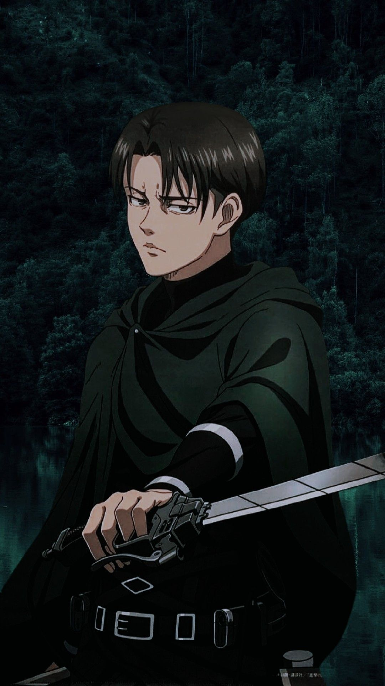

# Capitán Levi Ackerman: El Soldado Más Fuerte de la Humanidad

## Biografía y Liderazgo en el Cuerpo de Exploración

Levi Ackerman es el líder del escuadrón de operaciones especiales, conocido por su carácter **disciplinado**, su estilo de combate *letal* y el uso táctico de su equipo en misiones clave registradas como `operacion_muro_maria`.

División: Cuerpo de Exploración
Rango: Capitán de Escuadrón
Estado: Veterano de élite
Especialidad: Combate cuerpo a cuerpo contra titanes

### Estadísticas de Combate

1. Fuerza y agilidad: 10/10
2. Habilidad con equipo de maniobras tridimensionales: 10/10
3. Trabajo en equipo: 9/10

### Miembros Históricos del Escuadrón Levi

* Eld Jinn
* Oluo Bozado
* Petra Ral
* Günther Schultz

### Archivos de Inteligencia

* Base de datos externa: [Wiki de Attack on Titan](https://attackontitan.fandom.com)
* Ficha táctica clasificada: [Ver detalles del equipo](docs/detalles.md)

### Registro Visual

#### Retrato del Capitán (Imagen Local)

#### Centro de Reclutamiento e Instrucción (Imagen Externa Wikimedia)

### Registro de Enfrentamientos Notables

| Adversario | Ubicación | Resultado |
| :--- | :--- | :--- |
| **Titán Hembra** | Bosque de los Árboles Gigantes | Rescate exitoso de Eren |
| **Titán Bestia** | Distrito de Shiganshina | Victoria aplastante de Levi |
| **Escuadrón de Kenny** | Capilla subterránea Reiss | Misión cumplida |
